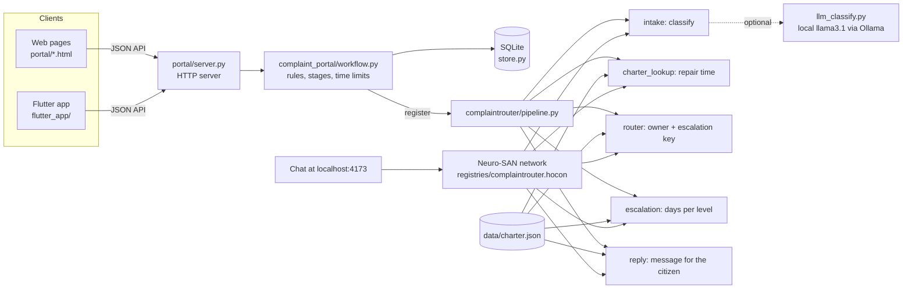

# Architecture

**Chennai Kural: Your Voice. A Better Chennai.** An unofficial hackathon prototype for Chennai water and
sewer complaints. It is not affiliated with CMWSSB and nothing it produces is an official reply.

## What it does

A citizen files a complaint. The system works out what kind of complaint it is, who owns it, how long the
charter allows for the repair, and what happens if that time runs out. The complaint then moves through
officers and field workers until the citizen confirms the problem is fixed with a one-time code.

## Design principle: models for language, code for facts

A model is good at reading messy human wording. It is not a safe source for deadlines, officer names or
reply text. So:

- A model may only **choose a complaint type** (and only from the charter's list).
- Every **timeline, owner, escalation day and reply sentence comes from `data/charter.json`** through
  deterministic Python tools.
- **Urgency comes from keyword rules**, so a model can never lower it.
- If the model is missing, slow or wrong, a keyword classifier takes over, and the screen says so.

## System overview

## The agentic system (Neuro-SAN)

`registries/complaintrouter.hocon` defines a Neuro-SAN agent network: one coordinator and five specialist
agents. The coordinator's instructions fix the order and the rules.

| Agent | Job | Python tool (CodedTool) |
|---|---|---|
| `complaint_coordinator` | Plans the work, calls the five agents in order, returns the final text | the LLM (llama3.1 via Ollama, or Gemini) |
| `intake_agent` | Classifies the complaint into a charter type and subtype, flags urgency and open questions | `intake.ComplaintIntake` |
| `charter_agent` | Looks up the charter's repair time for that type | `charter_lookup.CharterLookup` |
| `router_agent` | Names the owning unit and the escalation key | `router.ComplaintRouter` |
| `escalation_agent` | Gives the charter's escalation days for each officer level (only if days elapsed are given) | `escalation.EscalationChecker` |
| `reply_agent` | Writes the complete draft reply | `reply.ReplyDrafter` |

How the four things judges look for show up:

- **Coordination:** the coordinator calls `intake_agent`, `charter_agent`, `router_agent`,
  `escalation_agent`, `reply_agent` in a fixed order and passes each result to the next (type and subtype
  to the charter agent, the escalation key to the escalation and reply agents).
- **Tool use:** every agent is a Python tool that reads `data/charter.json`. Nothing is invented. The
  coordinator is told never to invent timelines, officer names or days elapsed.
- **Review:** the intake agent returns notes whenever a subtype or timeline had to be assumed, and marks
  the complaint for human review. The reply starts with a fixed DRAFT banner and lists "open items for the
  reviewer" whenever the router had to assume something. Officers confirm before anything is acted on.
- **Evaluation:** `examples/evaluate_router.py` measures the router on 45 labelled complaints (results in
  `summary.md`).

### How the portal relates to the network (please read)

The live portal does **not** call the Neuro-SAN network. When a complaint is registered the portal runs
`complaintrouter/pipeline.py`, which calls the **same five coded tools in-process**. We chose this on
purpose: registration must never depend on an LLM being up, and the facts must be identical every time. The
Neuro-SAN network exposes those same tools to an LLM coordinator (chat at http://localhost:4173) so the
router can be used conversationally and so the agent coordination can be inspected. The README explains how
to run it (`ns validate registries/complaintrouter.hocon` passes; a live `ns run` needs a model).

**Not done yet:** making the portal call the network, with the in-process pipeline as fallback.

## Life of a complaint

1. **Register.** The citizen signs up (name, mobile number, address, ward) and logs in with a code. They
   file a complaint. `workflow.register` picks the complaint ID (for example `CMP-20261018-0434`) and runs
   the router with that ID.
2. **Router.** `pipeline.run_complaint` classifies the complaint, looks up the repair time, names the owner,
   gets the escalation days and writes the message. The portal stores the message and the timeline with the
   complaint and shows both at once.
3. **Assign.** The complaint goes to the depot officer for its field and zone. The charter repair time sets
   the first time limit.
4. **Work.** A field worker accepts it. When the work is done the worker asks for completion, a six-digit
   code goes to the citizen, and the complaint closes only if the worker enters that code.
5. **Officer route.** An officer can also mark it resolved. The citizen is then asked whether it is fixed. If
   not, it goes to the ward office and then to the District Head Office.
6. **Time limits.** Every 30 seconds the portal checks time limits. When one passes, the complaint moves to
   the next level and the officers get a notice. Levels: Depot, Deputy Area Engineer, Area Engineer,
   Superintendent Engineer, District Head Office. `--demo-minutes 2` shortens every limit for a live demo.

## The router's message and timeline

The router's message (exact text from `reply.build_reply`, with the real complaint ID) is shown on the
registration screen as soon as the complaint is filed. The router's timeline (repair time and escalation days)
is shown as progress: each office, its time limit, and a marker for Done, Now, Next or Not needed that
follows the complaint through escalation. Code: `complaint_tools/complaint_portal/router_link.py`.

## Components

| Path | What it holds |
|---|---|
| `portal/server.py`, `portal/*.html`, `portal/assets/` | HTTP server, JSON API and the web pages |
| `complaint_tools/complaint_portal/` | Rules and stages (`rules.py`), workflow, SQLite storage (`store.py`), passwords and sessions (`auth.py`), workers, locations, SMS, router link |
| `complaint_tools/complaintrouter/` | The five router tools, the model step with its fallback, and the pipeline |
| `registries/` | The Neuro-SAN agent network and its manifest |
| `data/` | `charter.json` (timelines, owners, escalation days, helplines), zone and ward data, the evaluation test set |
| `flutter_app/` | Phone and web app for the same API |
| `examples/` | `run_pipeline.py` (routing without a model) and `evaluate_router.py` |
| `tests/` | 303 tests; none needs a model or the internet |

Data is kept in SQLite (tables: citizens, officers, workers, complaints, events, notices). Older database
files are upgraded automatically on start-up.

## Reliability and safety

- **Fallbacks:** model unreachable or invalid answer, then keyword classifier. Unknown wording, then
  "unclassified" and a human reviews it.
- **Model output is checked** against the charter's list of types before it is used.
- **Codes** (login and confirmation) are six digits, last 10 minutes, work once and lock after five wrong
  tries. Passwords are salted PBKDF2-SHA256. Session cookies are `HttpOnly` and `SameSite=Strict`.
- **Privacy:** the demo stores mobile numbers, addresses and complaint text in plain text in SQLite. Use only
  invented data. The hackathon rules do not allow personal data.

## Testing and evaluation

- 303 automated tests (portal, escalation, citizen and worker flows, accounts, locations, SMS with a fake
  provider, the router, and the router link). No model or internet is needed.
- A browser-engine check of the real registration and tracking pages against a running portal.
- `python examples/evaluate_router.py`: accuracy, urgent-case recall, human-review rate, risky errors and
  latency on 45 labelled complaints. The test set is small and written by the authors, so it shows behaviour
  on those examples only. The LLM classifier can be measured with `--llm` when Ollama is running; the script
  refuses to report LLM numbers if the model was not actually used.

## Limitations

- The portal does not call the Neuro-SAN network (see above).
- A live `ns run` and the LLM classifier were not exercised in the build environment (no Ollama there).
- The charter copy is from a development mirror, and the charter does not say whether its escalation days
  are cumulative or per level. The portal treats them as per level. CMWSSB should confirm both.
- The keyword classifier understands English only, and the evaluation shows it is weak on everyday wording.
- Demo only: no HTTPS, in-memory sessions and codes, plain-text personal data, SMS needs a provider account.
- The Flutter app was not compiled in the build environment.
